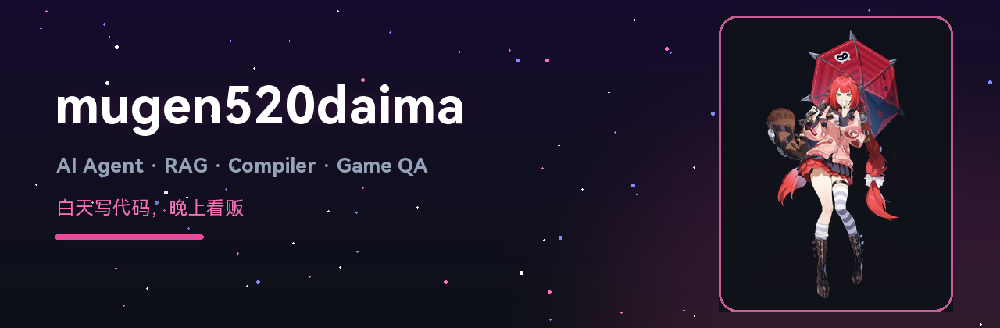
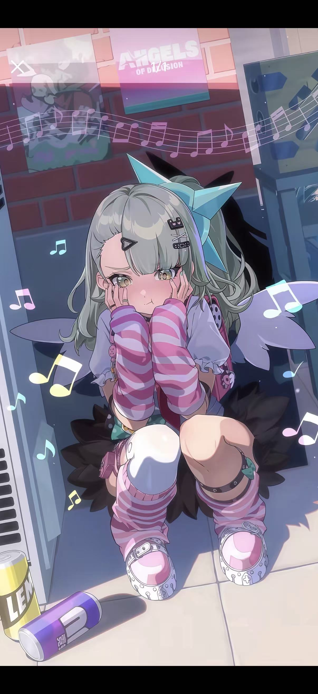
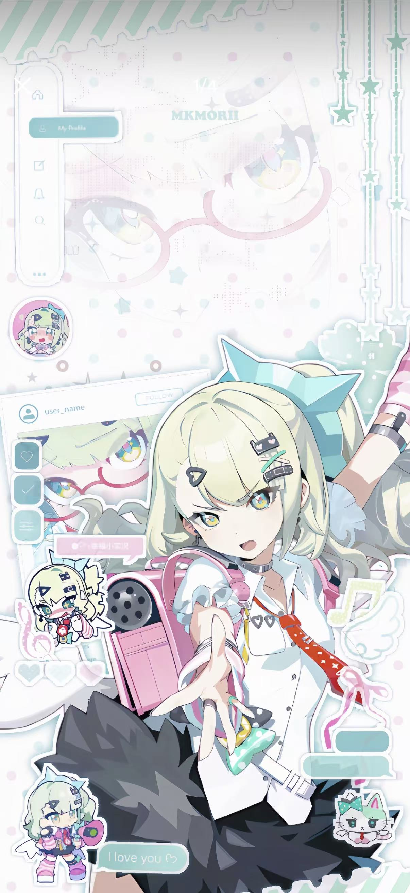

  

### Hi 大家好，我是 **mugen520daima** 👋

> 白天写代码，晚上看番 ｜ 绝区零·千夏推 ｜ 契约之吻·木更推

---

## 🚀 About Me

- 🔭 正在做：**AI Agent / RAG 应用 / 游戏 QA 自动化**
- 🌱 正在学：编译器构建、LLM 应用工程化、Agent 编排
- 💼 技术方向：`Python` · `Java` · `C++` · `TypeScript`
- 🎮 兴趣：二次元番剧与游戏，喜欢把爱好写进工具里

---

## 🛠️ Tech Stack

  

---

## 📊 GitHub Stats

---

## 🔥 Featured Projects

<table>
<tr>
<td width="50%">

### 🤖 [langchain-rag-ACG-agent](https://github.com/mugen520daima/-langchain-rag-ACG-agent)
基于 LangChain + RAG 的二次元角色智能体，让喜欢的角色"活"在对话里。

</td>
<td width="50%">

### 🐈 [neko-compiler](https://github.com/mugen520daima/neko-compiler)
自研编译器项目：词法 / 语法 / 语义 / 代码生成全链路实现。

</td>
</tr>
<tr>
<td width="50%">

### 🧪 [QA-agent](https://github.com/mugen520daima/QA-agent)
TypeScript 实现的 QA 智能体，覆盖测试编排与自动化检查。

</td>
<td width="50%">

### 📝 [code-review-agent](https://github.com/mugen520daima/code-review-agent)
代码评审 Agent，辅助发现安全与质量问题。

</td>
</tr>
</table>

📂 其他项目（点击展开）

- [rag_demo](https://github.com/mugen520daima/rag_demo) — RAG 检索增强生成示例
- [langchain-agent-money](https://github.com/mugen520daima/langchain-agent-money) — LangChain Agent 实践
- [agent_demo](https://github.com/mugen520daima/agent_demo) — Agent 基础 Demo
- [Tlias-](https://github.com/mugen520daima/Tlias-) — Java 智能学习辅助系统
- [-weller](https://github.com/mugen520daima/-weller) — 游戏物品/日志自动化检查工具（Python）
- [-](https://github.com/mugen520daima/-) — 力扣刷题记录（C++）

---

## 🎮 推しコーナー

<table>
<tr>
<td align="center">
 
<b>千夏 Chixia</b> 
<i>绝区零 Zenless Zone Zero</i>
</td>
<td align="center">
 
<b>木更 Kimi</b> 
<i>契约之吻 Engage Kiss</i>
</td>
</tr>
</table>

---

## 🖼️ Wallpaper Gallery

<table>
<tr>
<td align="center">
 
<b>星星眼特写</b> 
<i>粉毛兽耳 · 满眼都是星星 ✨</i>
</td>
<td align="center">
 
<b>街角的小失落</b> 
<i>绝区零 · Angels of Delusion</i>
</td>
<td align="center">
 
<b>拼贴风壁纸</b> 
<i>绝区零 · Angels of Delusion</i>
</td>
</tr>
</table>

---

## 🐍 Contribution Snake

---

<i>Thanks for visiting ⭐ if you like my projects!</i>

