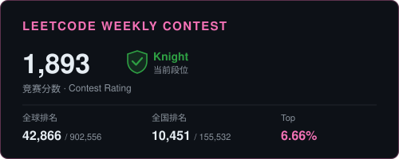

### Hi 大家好，我是 **mugen520daima** 👋

> 白天写代码，晚上看番 ｜ 技术宅男拯救世界

---

## 🧮 LeetCode 刷题

---

## 🚀 About Me

- 🔭 正在做：**AI Agent / 后端RD / 游戏 QA**
- 🌱 正在学：测试提效
- 💼 技术方向：`Python` · `Java` · `C++`
- 🎮 兴趣：二次元番剧与游戏，喜欢把爱好写进工具里

---

## 🛠️ Tech Stack

  

---

## 🔥 Featured Projects

<table>
<tr>
<td width="50%" valign="top">

<h3 align="center">
<a href="https://github.com/mugen520daima/weak-network-simulator">🌐 weak-network-simulator</a>
</h3>

**弱网模拟工具** — 基于 WinDivert 的可视化弱网测试工具。  
支持 **弱网 / 网络切换 / 断网重连** 三大场景，提供 Web UI 实时操作与数据统计。

</td>
<td width="50%" valign="top">

<h3 align="center">
<a href="https://github.com/mugen520daima/-langchain-rag-ACG-agent">🤖 langchain-rag-ACG-agent</a>
</h3>

**二次元角色智能体** — 基于 LangChain + RAG 构建，让你喜欢的 ACG 角色「活」在对话里，实现个性化角色扮演交互。

</td>
</tr>
<tr>
<td width="50%" valign="top">

<h3 align="center">
<a href="https://github.com/mugen520daima/langchain-agent-money">💰 langchain-agent-money</a>
</h3>

**基金助手 Agent** — 可嵌入微信的智能基金分析 Agent，基于 LangChain 实现自然语言查询与投资分析。

</td>
<td width="50%" valign="top">

<h3 align="center">
<a href="https://github.com/mugen520daima/neko-compiler">🐈 neko-compiler</a>
</h3>

**二次元主题商城** — Java 全栈电商项目，二次元风格界面设计，完整的商品管理与交易流程。

</td>
</tr>
</table>

---

## 🎮 推しギャラリー

<table>
<tr>
<td align="center" width="200">
 
<b>千夏 Chixia</b> 
绝区零 Zenless Zone Zero
</td>
<td align="center" width="200">
 
<b>木更 Kimi</b> 
契约之吻 Engage Kiss
</td>
<td align="center" width="200">
 
<b>瑶 · 星星眼 ✨</b> 
满眼都是星星
</td>
<td align="center" width="200">
 
<b>拼贴风壁纸</b> 
绝区零 · Angels of Delusion
</td>
</tr>
</table>

---

## 🐍 Contribution Snake

---

<i>Thanks for visiting ⭐ if you like my projects!</i>

